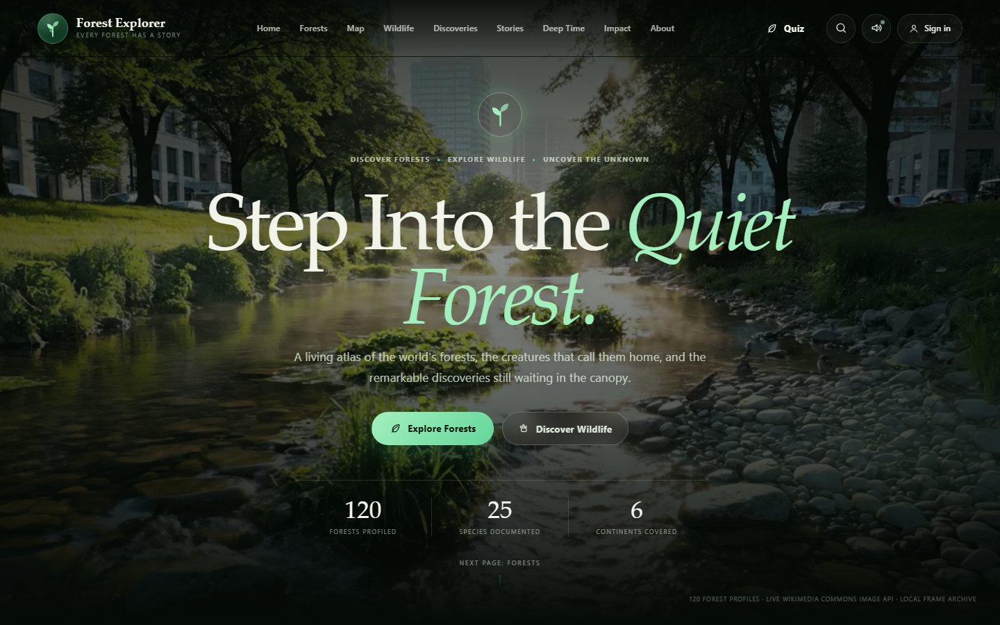
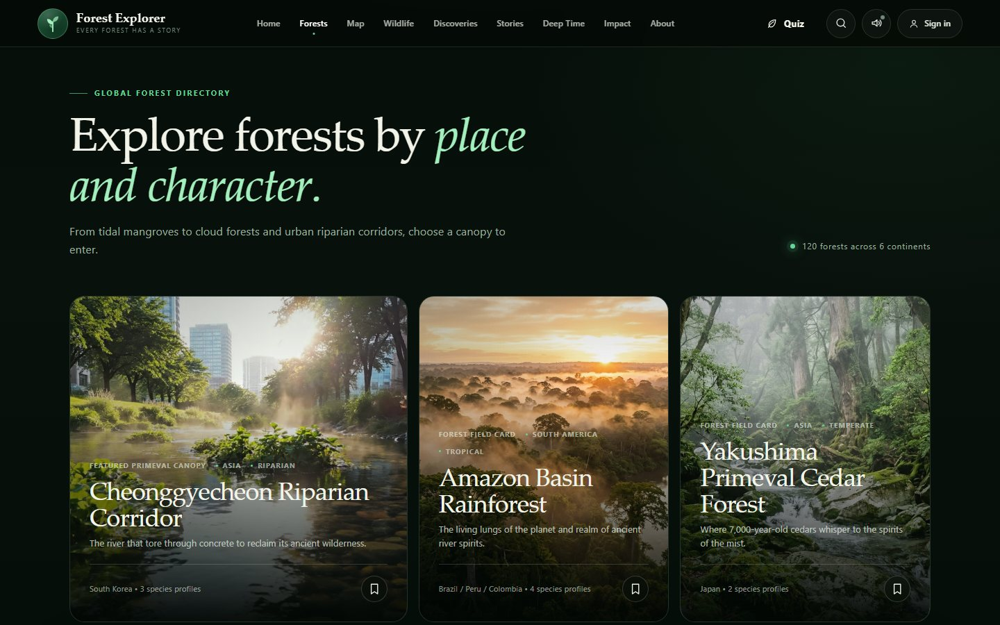
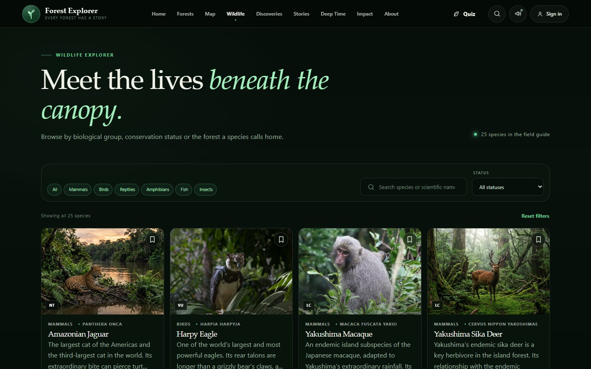
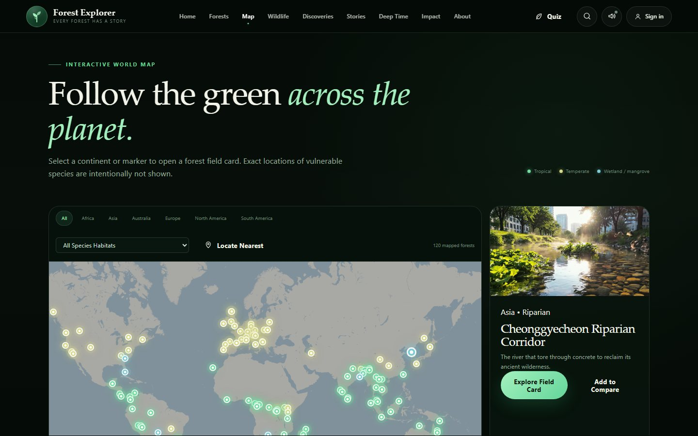

# Forest Explorer

**An offline-first atlas of Earth's last wild forests, rare wildlife, and deep-time natural history.**

A full-stack, zero-dependency web app that turns a curated natural-history dataset into an explorable field guide: a 192-frame canvas hero sequence, an interactive world map, cross-device sync, procedural soundscapes, a field journal, and a PWA that keeps working off-grid.

[](LICENSE)
[](https://nodejs.org)
[](#testing)
[](#pwa--offline-field-mode)
[](package.json)
[](#contributing)



## Table of Contents

- [Why Forest Explorer?](#why-forest-explorer)
- [Screenshots](#screenshots)
- [Features](#features)
- [Tech Stack](#tech-stack)
- [Quick Start](#quick-start)
- [Testing](#testing)
- [Project Structure](#project-structure)
- [REST API](#rest-api)
- [Atlas Data](#atlas-data)
- [PWA & Offline Field Mode](#pwa--offline-field-mode)
- [Configuration](#configuration)
- [Contributing](#contributing)
- [License](#license)

## Why Forest Explorer?

Most nature apps are thin wrappers around a photo gallery. Forest Explorer is built like a field instrument:

- **120 forests, 25 species, 10 field stories, 23 deep-time profiles, and 4 rare discoveries** with habitat, conservation status, coordinates, and image credits.
- **Zero runtime dependencies** in the browser and on the server. SQLite comes from Node's built-in `node:sqlite`; there is no `npm install` step.
- **Local-first, then synced.** Bookmarks, notes, and expedition progress persist offline in `localStorage` and reconcile with a SQLite backend through delta sync.
- **Accessible by default.** WCAG AA styling, keyboard focus traps, skip links, a live screen-reader announcer, and reduced-motion support.
- **Runs anywhere.** One `npm start`, no build tooling, no bundler, no framework lock-in.

## Screenshots

| Forests | Wildlife |
| --- | --- |
|  |  |

| Interactive map | Home |
| --- | --- |
|  |  |

## Features

### Atlas & discovery

- Filterable forest, wildlife, rare-discovery, story, and deep-time directories with pagination.
- Rich detail dialogs with habitat data, conservation status, image credits, and Wikimedia lightbox.
- Universal search with query highlighting that spans forests, species, stories, and discoveries.

### Interactive map

- Leaflet map with species habitat layers, continent filters, and deep links.
- "Locate Nearest Forest" using the Haversine formula and browser geolocation.

### Compare & field journal

- Side-by-side comparison matrix for 2–3 forests with shareable links (`#compare?ids=...`).
- Custom naturalist notes exported as structured JSON or a clean printable PDF.

### Accounts & cross-device sync

- Email/password accounts hashed with PBKDF2 SHA-512, plus cookie/header session tokens.
- Saved forests, species, and stories; notes; quiz progress; and delta sync via `POST /api/sync`.
- SQLite persistence out of the box, with optional PostgreSQL/Supabase via `DATABASE_URL` / `SUPABASE_URL`.

### Media curation

- Server-side Wikimedia Commons proxy with in-memory and disk caching.
- Responsive `srcset` generation and filtering of diagrams/emblems so galleries stay photographic.

### Experience

- 192-frame WebP canvas hero sequence with preloading and progress feedback.
- Procedural biome soundscapes for tropical rainforest, boreal taiga, temperate deciduous, and coastal mangrove.
- Field Knowledge Quiz, expedition tracker, and collectible naturalist badges.
- English, Spanish, French, German, and Japanese localization.
- Print stylesheet for offline field notes.

## Tech Stack

| Layer | Technology |
| --- | --- |
| Front end | Vanilla ES Modules, Canvas 2D, Web Audio API, Service Worker |
| Backend | Node.js HTTP server, `node:sqlite`, PBKDF2 SHA-512 |
| Map | Leaflet 1.9 (CDN) |
| Styling | Hand-written CSS with custom properties and print styles |
| Data | JSON datasets plus generated SQLite database |
| Tests | Node.js built-in `node:test` and `node:assert` |

## Quick Start

Requires **Node.js 22.5+** (24 LTS recommended) for the built-in SQLite module.

```bash
git clone https://github.com/Diva-L123/forest-explorer.git
cd forest-explorer
npm start
```

Open <http://localhost:3000>.

There is no install step and no build step. The server creates `data/forest_explorer.db` on first run and seeds the local demo admin account:

- **Email:** `explorer@forest.app`
- **Password:** `QuietForest2026!`

The port defaults to `3000` and automatically increments if it is busy. Override it with `PORT=8080 npm start`.

## Testing

```bash
npm test
```

The suite runs 21 tests covering the REST backend (auth, bookmarks, notes, sync, admin review, telemetry), JSON dataset integrity, and client utility math such as Haversine distance and area formatting.

```bash
npm run check   # syntax-check the server entry point
```

## Project Structure

```text
.
├── index.html                  # Application shell and SVG icon sprite
├── styles.css                  # Responsive, accessible, print-ready styling
├── manifest.webmanifest        # PWA manifest
├── sw.js                       # Service Worker caching strategy
├── server.js                   # Entry point
├── app.js                      # Legacy single-file client (kept for reference)
├── server/
│   ├── index.js                # Static server and REST API router
│   ├── db.js                   # SQLite initialization and schema
│   ├── auth.js                 # Accounts, sessions, bookmarks, notes
│   ├── sync.js                 # Delta sync and conflict resolution
│   ├── mediaProxy.js           # Wikimedia proxy and caching
│   ├── admin.js                # Submissions and image uploads
│   └── telemetry.js            # Privacy-friendly analytics and error reporting
├── src/
│   ├── main.js                 # Bootstrap and lifecycle orchestration
│   ├── core/                   # Configuration and reactive state
│   ├── services/               # API client, audio, hero sequence, i18n
│   ├── features/               # Atlas, map, compare, journal, search,
│   │                           # detail, gamification, auth, PWA, navigation
│   └── utils/                  # DOM helpers, accessibility, formatters
├── data/                       # Atlas JSON datasets and SQLite database
├── docs/                       # README screenshots
├── scripts/                    # Data enrichment and asset utilities
├── test/                       # node:test suites
└── frames_webp/                # 192 optimized hero frames
```

## REST API

| Method | Endpoint | Purpose |
| --- | --- | --- |
| GET | `/api/health` | Health and version check |
| POST | `/api/auth/register` | Create an account |
| POST | `/api/auth/login` | Start a session |
| POST | `/api/auth/logout` | End a session |
| GET | `/api/auth/me` | Current user |
| GET | `/api/user/data` | Bookmarks, notes, progress |
| POST/DELETE | `/api/user/save` | Save or remove an item |
| POST/PUT/DELETE | `/api/user/notes` | Create, edit, delete field notes |
| POST | `/api/user/progress` | Update expedition/quiz progress |
| POST | `/api/sync` | Delta sync with conflict resolution |
| GET | `/api/media/wikimedia` | Cached Wikimedia Commons proxy |
| POST | `/api/admin/submit` | Submit editorial content |
| GET | `/api/admin/submissions` | List submissions |
| POST | `/api/admin/review` | Approve or reject a submission |
| POST | `/api/admin/upload` | Upload an image |
| POST | `/api/telemetry/event` | Record a privacy-friendly event |
| POST | `/api/telemetry/errors` | Report a client error |
| GET | `/api/telemetry/stats` | Aggregate telemetry |

## Atlas Data

All atlas content lives in `data/`:

| File | Records |
| --- | --- |
| `forests.json` | 120 forests |
| `species.json` | 25 species |
| `stories.json` | 10 field stories |
| `prehistoric.json` | 23 deep-time profiles |
| `discoveries.json` | 4 rare discoveries |

Image attribution is tracked in `image_credits.json`, `new_image_credits.json`, and `species_credits.json`. Media is sourced from Wikimedia Commons and remains subject to its respective licenses.

## PWA & Offline Field Mode

The app installs as a standalone PWA. The Service Worker pre-caches the application shell, serves static assets cache-first, and falls back to cached API data when offline. A regional **Field Pack** downloader stores the forests you plan to visit so the atlas remains usable without a connection.

## Configuration

| Variable | Default | Description |
| --- | --- | --- |
| `PORT` | `3000` | HTTP port |
| `DB_PATH` | `data/forest_explorer.db` | SQLite database location |
| `DATABASE_URL` | – | Optional PostgreSQL connection string |
| `SUPABASE_URL` | – | Optional Supabase project URL |

## Contributing

Contributions are welcome. Please keep the project dependency-free, run `npm test` before opening a pull request, and match the existing ES Module structure. For new atlas entries, include image credits and verify the JSON schema against `test/data.test.js`.

If Forest Explorer is useful to you, a star helps other people find it.

## License

[MIT](LICENSE) © Diva-L123

Atlas photography and media remain the property of their original creators; see the credit files in `data/`.
